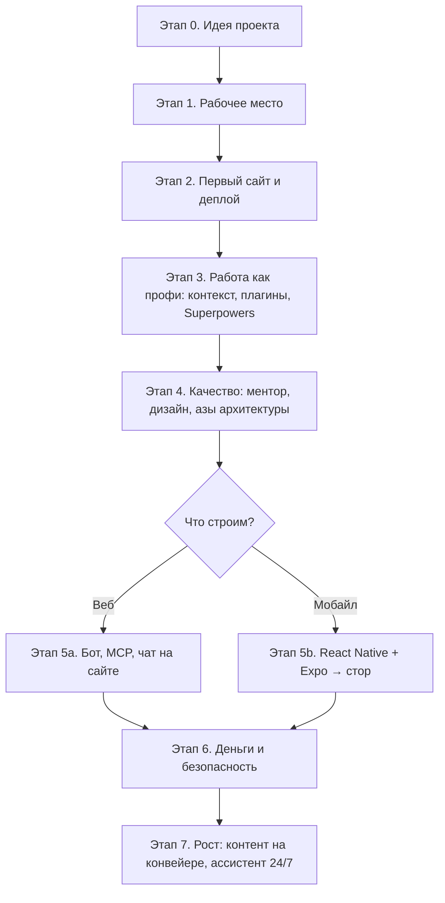

# 🗺 Роадмап: от нуля до своего ИИ-продукта

Путь собран из 14 уроков курса. Двигайтесь по этапам: каждый опирается на предыдущий. Время указано примерно, для темпа «пара вечеров в неделю».

---

## Этап 0. Идея проекта (1 вечер)
**Результат:** понятно, что вы строите и для кого.
- Сформулируйте проблему, которую решаете (примеры в [[Проекты-участников]]).
- Прогоните идею через скилл **grill-me**: ИИ задаст неудобные вопросы → [[Урок-02-Проект-и-суперсилы|урок 2]].
- Запишите идею в `docs/idea.md` своего проекта.

## Этап 1. Рабочее место (1–2 вечера)
**Результат:** всё установлено, Claude отвечает в терминале.
- Git, Homebrew (macOS), Claude Code и Claude Desktop → [[Урок-01-Ландшафт-2026-и-установка|урок 1]]
- VS Code → [[Урок-03-Практика-разбор-проектов|урок 3]]
- Голосовой ввод (Wispr Flow / Handy), чтобы ставить задачи голосом → урок 2
- Тариф: для активной разработки лимитов Pro ($20) мало, рассчитывайте на Max.

## Этап 2. Первый сайт и деплой (2–3 вечера)
**Результат:** ваш сайт открывается по ссылке.
- Лендинг на localhost («создай лендинг как пример на локалхост») → урок 1
- Скиллы через `npx skills add` → урок 2
- Деплой на Vercel → урок 2. Первый деплой может съесть ~40k токенов, это нормально.

## Этап 3. Работа как профи (1 неделя)
**Результат:** Claude знает ваш проект и работает по плану, а не наугад.
- Контекст как код: CLAUDE.md, правила, документация → [[Урок-04-Вайбкодинг-PRO-контекст-как-код|урок 4]]
- Плагины из маркетплейса, только нужные → урок 4
- **Superpowers**: планирование, субагенты, проверка → [[Урок-05-Superpowers-под-капотом|урок 5]]
- **Context7** (обязательно) и **Graphify** → урок 5
- Звуковой сигнал, когда Claude закончил → [[Промпты]]

## Этап 4. Качество (1 неделя)
**Результат:** проект выглядит прилично и вы понимаете, как он устроен.
- Скилл **vibe-coding-mentor**: «сделай диагностику и установи всё, что нужно» → [[Урок-06-Улучшаем-проект|урок 6]]
- Дизайн: Google Stitch, GetLayers, UI Skills → уроки 6–7
- Азы: фронт, бэк, API, домен, Docker → [[Урок-07-Азы-сервер-фронт-бэк-API-Docker|урок 7]]
- Термины RAG, harness, CLI → [[Глоссарий]]
- Harness: ECC, Ralph, диаграммы в draw.io → [[Урок-08-Harness-и-идея-мобильного-приложения|урок 8]]

## Этап 5a. Веб: бот, MCP, чат (1 неделя)
**Результат:** у продукта есть Telegram-бот и/или ИИ-чат на сайте.
- Свой MCP-сервер, бот через @BotFather, чат-виджет, деплой → [[Урок-11-Свой-MCP-бот-и-чат-на-сайте|урок 11]]

## Этап 5b. Мобильное приложение (1–2 недели)
**Результат:** приложение на телефоне, затем в сторе.
- Мега-промпт ментора: идея → спецификация → дизайн-система → экраны → [[Промпты]], урок 8
- React Native + Expo, запуск в Expo Go → [[Урок-09-Мобильное-приложение-React-Native-Expo|урок 9]]
- Облачная сборка и публикация → [[Урок-10-От-идеи-до-магазина|урок 10]]. Аккаунт разработчика Apple платный, узнайте цену заранее.

## Этап 6. Деньги и безопасность (2–3 вечера)
**Результат:** проект принимает оплату и проверен на дыры.
- Платежи: Finik, xPay, Tribute (уроки 4), MKassa от Mbank → [[Урок-12-Сайт-который-принимает-деньги|урок 12]]
- Пентест-агент Strix → урок 12

## Этап 7. Рост и автоматизация (по желанию)
- Контент на конвейере: карусели, рилсы, ИИ-двойник → [[Урок-13-Бонус-Контент-на-конвейере|урок 13]]
- Личный ИИ-ассистент 24/7 на своём сервере → [[Урок-14-Бонус-Личный-ассистент-на-сервере|урок 14]]
- Расскажите о проекте (пост в LinkedIn, демо в чате) и найдите первых клиентов.

---
➡️ Отмечайте прогресс в [[02-Чеклист]] · [[00-Начни-здесь|🏠 Главная]]
